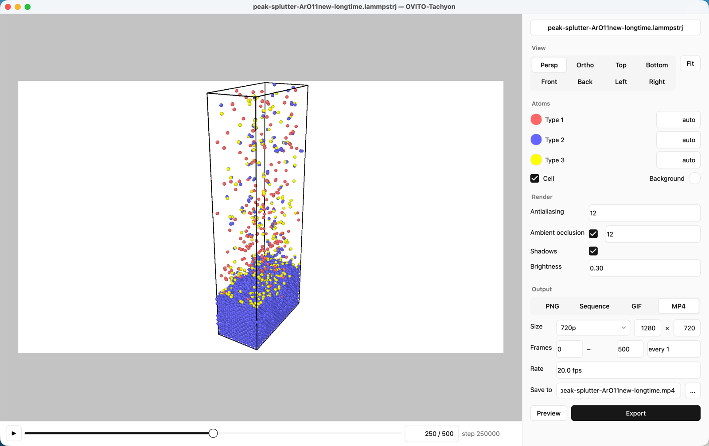
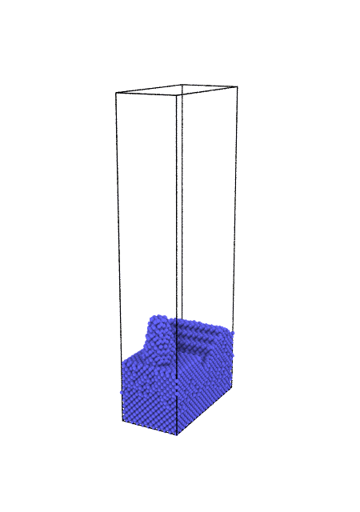
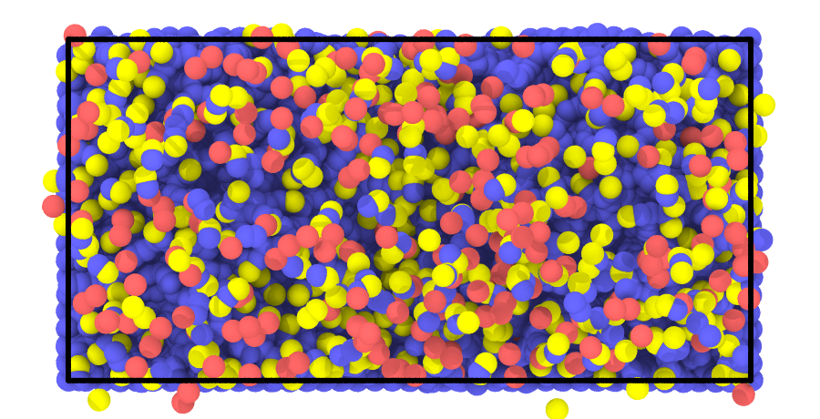

<p align="center">
  <picture>
    <source media="(prefers-color-scheme: dark)" srcset="docs/logo-dark.svg">
    
  </picture>
  <br><br>
  <picture>
    <source media="(prefers-color-scheme: dark)" srcset="docs/wordmark-dark.svg">
    
  </picture>
</p>

<p align="center">
  用 Tachyon 光线追踪渲染分子动力学轨迹：打开、旋转、导出 PNG · GIF · MP4
</p>

<p align="center">
  <a href="https://github.com/erwanjun/ovito-tachyon/releases/latest"></a>
  
  
  
  <a href="LICENSE"></a>
</p>

<p align="center">
  <a href="#下载">下载</a> ·
  <a href="#功能">功能</a> ·
  <a href="#使用">使用</a> ·
  <a href="#python-库">Python 库</a> ·
  <a href="#从源码构建">构建</a>
</p>

<br>

<p align="center">
  
</p>

<table align="center">
  <tr>
    <td align="center"></td>
    <td align="center"></td>
  </tr>
</table>

## 下载

| 系统 | 安装包 |
|---|---|
| macOS 12+ · Apple 芯片 | [`OVITO-Tachyon-macOS-arm64.dmg`](https://github.com/erwanjun/ovito-tachyon/releases/latest) |
| Windows 10 / 11 · x64 | [`OVITO-Tachyon-Windows-x64-setup.exe`](https://github.com/erwanjun/ovito-tachyon/releases/latest) · 免安装 `portable.zip` |

安装包未做付费代码签名，第一次打开会被系统拦一下：

- **macOS**　在“应用程序”里右键 OVITO-Tachyon →“打开”。仍被拦时运行
  `xattr -dr com.apple.quarantine /Applications/OVITO-Tachyon.app`
- **Windows**　SmartScreen 提示时点“更多信息”→“仍要运行”

## 功能

- **读取**　OVITO 支持的所有格式：LAMMPS dump / data、XYZ、POSCAR、PDB、GSD……几百 MB 的轨迹秒开
- **视角**　鼠标自由旋转、平移、缩放，或一键切到透视 / 正交 / 六个方向的正视图
- **外观**　按原子类型显示或隐藏、改颜色和半径；模拟盒开关；背景色
- **渲染**　内置 Tachyon 光线追踪，环境光遮蔽与阴影，默认效果与 OVITO 自带的 TachyonRenderer 一致
- **导出**　PNG、PNG 序列、GIF、MP4（H.264），自选分辨率（720p 到 4K）、帧范围、间隔和帧率
- **界面**　中文 / English，跟随系统浅色与深色模式

## 使用

1. 打开轨迹文件，或直接拖进窗口
2. 调好视角：视口中的白色区域就是导出画面
3. 在右侧选择格式、尺寸、帧范围与帧率
4. 点“预览”看当前帧的渲染效果，点“导出”生成文件

语言在菜单 **Language / 语言** 中切换。

## Python 库

桌面软件背后的渲染器也可以在 OVITO 脚本里直接使用：

```bash
pip install ovito ovito-tachyon
```

```python
from ovito.io import import_file
from ovito.vis import Viewport
from ovito_tachyon import TachyonExporter
from ovito_tachyon.export import export, frame_list

pipeline = import_file("dump.lammpstrj")
pipeline.add_to_scene()

vp = Viewport(type=Viewport.Type.Perspective, camera_dir=(-1, -0.6, -0.5))
vp.zoom_all(size=(1920, 1080))

exporter = TachyonExporter(ambient_occlusion_samples=16)
exporter.render("frame.png", viewport=vp, size=(1920, 1080), frame=0)
export(exporter, "movie.mp4", "mp4", frame_list(0, 500, 5), viewport=vp, size=(1920, 1080), fps=24)
```

<details>
<summary>参数与支持范围</summary>

<br>

`TachyonExporter` 的参数与 `ovito.vis.TachyonRenderer` 同名：`antialiasing`、`antialiasing_samples`、
`ambient_occlusion`、`ambient_occlusion_brightness`、`ambient_occlusion_samples`、`direct_light`、
`direct_light_intensity`、`shadows`、`depth_of_field`、`focal_length`、`aperture`、`max_ray_recursion`，
另有 `material=Material(...)` 与 `threads`。默认光照逐像素拟合过 OVITO 的 TachyonRenderer；
想更亮可用 `Material(ambient=0.4)`，加高光用 `Material(phong=0.3)`。

| `render()` 参数 | 说明 |
|---|---|
| `filename` | `.png` / `.ppm`；为 `None` 时只返回 `(高, 宽, 3)` 的 `uint8` 数组 |
| `viewport` | `ovito.vis.Viewport`；省略时用 (-1,-1,-1) 方向透视并自动缩放 |
| `pipelines` | 默认 `ovito.scene.pipelines`，也可传入一个或多个 Pipeline |
| `zoom_all` | 按渲染几何体重新调整相机距离（无 viewport 时默认开启） |
| `scene_file` | 另存生成的 Tachyon 场景文件 `.dat` |

支持：球形粒子（半径按 `Radius` → 类型半径 → `ParticlesVis.radius`，颜色按 `Color` → 类型颜色，
`Transparency`，选中粒子显示为红色）、键（半键着色、`Color` / `Transparency`、跨周期边界）、
模拟盒、透视 / 正交相机与景深。
暂不支持：表面网格、位错线、非球形粒子（按球形渲染）、周期性镜像、视口叠加层、透明背景。

命令行：`ovito-tachyon dump.lammpstrj -o out.png --size 1600 1200 --view top --frame -1`

Tachyon 可执行文件的查找顺序：环境变量 `OVITO_TACHYON_EXE` → 包内 `ovito_tachyon/bin/` → `PATH` 中的 `tachyon`。

</details>

## 从源码构建

```bash
pip install build
python -m build                                    # wheel：setup.py 把 vendor/tachyon 编译进包内
pip install dist/*.whl ovito imageio-ffmpeg pyinstaller pillow
pyinstaller packaging/ovito-tachyon.spec           # dist/OVITO-Tachyon.app 或 dist/OVITO-Tachyon/
sh packaging/build_dmg.sh 0.1.1                    # macOS：release/*.dmg
```

编译 Tachyon 需要 C 编译器（macOS：Xcode Command Line Tools；Windows：MSVC）。不要在 exFAT 分区上构建。
推送 `v*` tag 后，[`release.yml`](.github/workflows/release.yml) 会在 GitHub Actions 上构建 dmg、
Windows 安装包与免安装 zip，在打包好的程序里跑一遍 `--selftest`，再发布到 Releases。

## 许可与致谢

本项目代码使用 MIT 许可。随附的 [Tachyon](vendor/tachyon) 0.99b6（John E. Stone）使用 BSD 3-clause 许可，见 [`LICENSE`](LICENSE)。
桌面软件还打包了 [OVITO](https://www.ovito.org) Python 模块（MIT）、Qt for Python / PySide6（LGPLv3）与
imageio-ffmpeg 提供的 [FFmpeg](https://ffmpeg.org)（GPL）。界面配色取自 [shadcn/ui](https://ui.shadcn.com)（MIT）。
